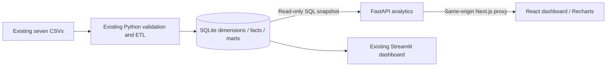

# FoodFlow Intelligence — Phase 1

This phase adds a Next.js 15 / React 19 / Tailwind CSS 4 dashboard and a FastAPI service over the existing SQLite dimensional warehouse. The Streamlit applications, ETL, cloud integrations, and bundled datasets remain available unchanged. No new external credentials are needed.

## Run locally

From the repository root (Python 3.12 and Node.js 22+):

```bash
python -m venv .venv-api
.venv-api/bin/python -m pip install --upgrade "pip>=26.2,<27"
.venv-api/bin/python -m pip install -r requirements-api.txt
.venv-api/bin/python -m src.pipeline build
npm ci --prefix frontend
```

`build` consumes the existing CSVs. Avoid `src.pipeline all` or `generate` if you want to preserve the bundled files.

Start two terminal sessions from the repository root:

```bash
.venv-api/bin/python -m uvicorn api.main:app --host 127.0.0.1 --port 8000
```

```bash
npm run dev --prefix frontend
```

The frontend uses port 3000 and proxies `/api/*` to FastAPI on port 8000. `FOODFLOW_API_URL` overrides the upstream URL when starting/building Next.js. `FOODFLOW_DB_PATH` overrides the SQLite path for FastAPI. There are no browser-side credentials or direct database connections. No CORS configuration is required for this same-origin proxy.

## Validate

```bash
.venv-api/bin/python -m pip install -r requirements-test.txt
.venv-api/bin/python -m pytest -q
npm run build --prefix frontend
npm run typecheck --prefix frontend
# With FastAPI and Next.js already running:
npx --prefix frontend playwright install chromium
npm run test:e2e --prefix frontend
curl --fail http://127.0.0.1:8000/health
curl --fail http://127.0.0.1:3000/api/analytics
.venv-api/bin/python scripts/verify_phase1.py
```

For the optimized frontend, run `npm run build --prefix frontend` followed by `npm run start --prefix frontend`. Production hosting, authentication, rate limiting, containerization, and CI are Phase 5 work; use the platform’s access-controlled preview for port 3000; keep FastAPI on loopback. Do not publish this unauthenticated dashboard as a public deployment.

## Data contracts and definitions

`GET /analytics?city=Denver&start=2025-01-01&end=2025-12-31` supports inclusive ISO calendar dates. Omitted filters select all available data. Invalid date ranges return 422. Empty selections return zero counts/revenue, null undefined averages/rates, and empty series. A missing/unusable warehouse returns 503 without creating a database. `GET /health` checks the order table, rather than just process liveness. OpenAPI documentation is available at the API's `/docs` route.

All panels use parameterized SQL inside a single read transaction. Connections open with SQLite `mode=ro` and `query_only`; API requests cannot build or mutate the warehouse. The current ETL remains a separate explicit operation. Errors do not expose database paths or SQL internals.

- Revenue: delivered order totals, including delivery fees.
- Delivery completion (`fulfillment_rate` in the API): delivered orders divided by all selected orders; this measures delivery completion, not inventory fill rate.
- Delivery time and average order value: delivered orders only.
- Ratings: reviews joined to selected orders, so date/city filters apply consistently.
- Daily demand: counts of all selected orders; missing calendar dates are not filled with fabricated observations.
- Products: units and item revenue from delivered orders; item revenue excludes delivery fees.
- Ranking: top 10 restaurants by revenue and top 10 foods by units. Ties use stable identifiers.
- CSV export: the exact filtered daily series, with delivered orders and revenue included.

The source is synthetic delivery data. There are no supplier, stock-level, purchase-order, lead-time, or replenishment records. Inventory and supplier KPIs cannot be inferred reliably. The demand outlook explicitly reports that no model has been trained/evaluated; its decorative illustration is labeled and contains no predictions. Phase 3 will add forecasting after temporal holdout evaluation. No forecast accuracy, improvements, or comparative KPI deltas are invented.

## Architecture



## Remaining phases

2. Incremental ETL, operational metadata/logging, PostgreSQL dimensions and facts, and orchestration justified by actual workflow dependencies.
3. Additional supported KPIs, SQL reports, temporal forecasting evaluation, and anomaly detection; inventory analysis requires additional source records.
4. Natural-language assistant that executes governed queries and cites actual results.
5. Broader automated tests, model evaluation artifacts, Docker, CI/CD, deployment and operational documentation.

Phase 1 stops here for review before those changes begin.

For an existing system Chromium, set `CHROMIUM_PATH=/usr/bin/chromium` when running the browser tests. Browser tests compare UI and exported rows with real API results, check filters, mobile layout, and retry behavior. Browser error/empty-state tests use explicit network fixtures; they are not evidence of real warehouse totals.

## Phase 1 validation results

Validated in this workspace against the bundled warehouse:

- Python: **24 passed** (17 existing tests and 7 API tests). One upstream Starlette/httpx deprecation warning remains.
- Next.js optimized production build: **passed**.
- TypeScript: **passed**.
- Chromium end-to-end: **8 passed**, covering real API/UI reconciliation, combined city/date filters, filtered CSV contents, chart switching and tooltips, date validation, empty selection, service recovery, and layouts at 320, 390, 768, and 1440px.
- Live API health and Next.js API proxy: **passed**.
- Existing source/data/pipeline/SQL/Streamlit files: no changes.

These checks validate Phase 1 locally; they do not establish deployment readiness or model accuracy. No model results were generated.

## Preview the application

On your own machine, after starting both services, open `http://127.0.0.1:3000` in a browser. API documentation is at `http://127.0.0.1:8000/docs`. Select Denver, then March 1 through June 30, 2025: delivered revenue should be **$8,428.55**, with **145 delivered orders** out of **167 orders**. Reset filters to return to **$144,709.13** and **2,645 delivered orders** out of **3,000 orders**. These values were read from the bundled warehouse, not hardcoded into the application.

In Codex Web, do not open a raw localhost address: it points to your own device. The frontend is configured for `0.0.0.0:3000`, while FastAPI remains private on `127.0.0.1:8000`. Use the platform-forwarded preview for port 3000 if your session supports it. The available tools cannot create or inspect Codex’s preview gateway, so browser access through that gateway must be distinguished from the verified application/network checks. If ports 3000 or 8000 are occupied, stop your previous instances before starting another; avoid leaving a stale Next.js process running after a production rebuild.

Use the dedicated `.venv-api` for Phase 1. The optional dbt/cloud environment remains separate. Changing `FOODFLOW_API_URL` for an optimized build requires rebuilding Next.js so its proxy routes point to the intended upstream.

See [Phase 1 review and dependency audit](docs/phase1-review.md) for verification scope, fixes, and the unresolved optional dbt dependency constraint.

## Codex Web cloud preview (no local installation)

Both services are prepared in this cloud workspace. Start them in a persistent cloud terminal with:

```bash
cd /workspace/foodflow-ai
bash scripts/start_preview.sh
```

This starts the optimized frontend on **0.0.0.0:3000** and FastAPI on **127.0.0.1:8000**. The browser needs only the forwarded frontend port; `/api/analytics` is proxied server-side to FastAPI. No browser-side localhost API URL, CORS exception, or exposed backend port is required. Do not select port 8000 or the older Streamlit port 8501 for the Next.js dashboard.

The startup script checks for occupied ports, refuses to reuse stale services, waits for the API through Next.js, and stops its own companion process if either service exits. Stop the script to stop both services. Application logs are in ignored `logs/preview-web.log` and `logs/preview-api.log`. Processes must restart after a cloud environment is restored.

In **Web preview → Open in**, use the platform-forwarded URL for **port 3000**, if port selection is available. A URL whose hostname is `127.0.0.1`, `localhost`, or `0.0.0.0` is not a forwarded cloud URL; those addresses must not be used as links in your browser. If the UI provides only such a URL or still reports a loopback connection refusal, preview forwarding is not working in that session. This repository cannot manufacture a supported Codex preview hostname. No local installation is needed to run or test the app in this workspace, but the platform must supply browser routing for an interactive preview.

Diagnosis: before the fix both services returned 200 on loopback, but the container network address refused port 3000. After the fix, port 3000 listens on all interfaces; direct container-network HTTP and a Chromium browser load the dashboard, retrieve warehouse results, and filter Denver correctly. Automated traffic to the private container IP must use a direct local route: the outbound Internet proxy returns “Domain forbidden” for that private destination. That egress proxy is not a public preview URL and changing the Internet allowlist does not create an inbound preview.

Verified after the change: 24 Python tests, 8 loopback browser tests, 10 direct container-network warehouse reconciliation cases, and a separate Chromium test via the container network address. All passed. A preview-gateway session in the user’s browser remains unverified.

## Hosted demo alternative

If Codex Web preview forwarding is unavailable, the Phase 1 demo can run as one Render Docker service. See [browser-only deployment instructions](docs/RENDER_DEPLOYMENT.md), `render.yaml`, and `Dockerfile`. This is a bounded demo deployment; it does not start Phase 2 or replace the later production-hardening work.
