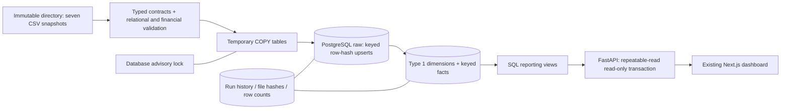

# Phase 2 — incremental PostgreSQL warehouse

Phase 2 adds a PostgreSQL data engineering workflow alongside the existing SQLite ETL and Streamlit/Next.js applications. It does not replace the bundled CSVs, change the Phase 1 Render service, deploy a hosted database, or start Phase 3 modeling.

## Architecture and decisions



The CSVs have stable IDs but **no update timestamps**. The loader scans each complete snapshot and compares canonical SHA-256 row hashes. It writes only inserted or changed rows; it does not claim incremental extraction or log-based CDC. This catches late arrivals and corrections to historical orders that a maximum-date watermark would miss.

Dimensions use stable source IDs as keys and **Type 1 corrections** (current values). Facts have enforced foreign keys, typed dates, fixed-precision numeric money, domain checks, indexes, and run lineage. There is no Type 2 history or multi-source key reconciliation yet. Changing a menu's food mapping also refreshes the affected item facts, even when the item source rows did not change.

All raw upserts, dimensional/fact changes, publication checks, and the successful run record commit together. Views reflect that same committed warehouse; there is no independently refreshed materialized cache. A rejected run leaves the previous data visible and writes its failure to `foodflow_ops.runs` outside the rolled-back publication transaction. Logs emitted before `run_published` describe provisional work, not committed updates. Failed-run row counts are explicitly nested under `attempted` with `committed: false`.

An advisory lock permits one cooperating writer per database. An overlapping invocation exits **75**, without interleaving source generations. If a process loses its connection before publication, its next replacement marks the leftover RUNNING record **ABANDONED**, not successful. A failure that also loses database connectivity may not immediately persist a FAILED record; subsequent interrupted-run recovery handles that case.

Readers use a dedicated SELECT-only login, a read-only connection, a five-second statement timeout, and a **REPEATABLE READ** transaction across every dashboard panel. A new ETL commit cannot mix old/new values within one API response.

## Prepare the cloud workspace

From the repository root, in the Phase 2 branch:

```bash
.venv-api/bin/python -m pip install -r requirements-test.txt -r requirements-postgres.txt
.venv-api/bin/python -m pip check
docker compose -f docker-compose.postgres.yml up -d --wait
export FOODFLOW_ETL_DATABASE_URL=postgresql://postgres@127.0.0.1:55432/foodflow
bash scripts/run_postgres_etl.sh
.venv-api/bin/python -m src.warehouse.cli grant-reader --role foodflow_reader
```

The development database is loopback-bound on **55432** with an isolated named volume. It deliberately uses **trust authentication only for this development workspace**; other local processes could connect. Never expose that service publicly or reuse this authentication configuration for hosted PostgreSQL. No real credentials are included in the repository. The reader login is initialized only on first volume creation; the idempotent `deploy/postgres/dev-init.sql` can be reapplied by an administrator if initialization was interrupted.

The initial `run` applies the non-destructive schema-v1 migration. Subsequent runs verify the version rather than rerunning view DDL. The current implementation handles version 1; future migrations need explicit reviewed upgrade code. To initialize without loading data, use `python -m src.warehouse.cli migrate` with the same environment and interpreter.

Use a provisioning account for initial schemas/role grants. For hosted use, provision a separate restricted loader account with the needed raw/analytics/ops DML, schema-version read access, and temporary-table permissions. Provision a fresh dedicated reader through secure database tooling, then grant only analytics-schema USAGE/SELECT. `grant-reader` adds read grants; it does not revoke privileges from an existing writer or make an administrator safe to use as a reader. Configure production DSNs through secure environment settings. Do not put credentials in commands, Git files, logs, screenshots, or chat. Require the hosted database's supported TLS verification (for example `sslmode=verify-full` with its trusted CA).

The existing `.venv`/dbt certificate dependency issue is separate; Phase 2 uses `.venv-api` and does not require dbt, Snowflake, or Airflow.

## Run, retry, and inspect

```bash
# Read only the existing bundled CSVs; never generate or rewrite them.
bash scripts/run_postgres_etl.sh
# Repeat safely: unchanged input produces zero warehouse data changes.
bash scripts/run_postgres_etl.sh
# Use a separate complete, immutable incoming batch directory.
FOODFLOW_RAW_DIR=/path/to/published-batch bash scripts/run_postgres_etl.sh
.venv-api/bin/python -m src.warehouse.cli status
```

Keep all seven source files immutable for the duration of a run. The producer must finish publishing the complete batch before invoking ETL. This repository does not include an upstream delivery-system exporter or a cross-file atomic publication protocol. File hashes and row counts record exactly what was read. Missing files, schema drift, malformed typed values, non-finite money, duplicate keys, missing required fields, broken references, inconsistent order/review/restaurant relationships, invalid domains, and failed order arithmetic/reconciliation reject publication.

**Partial delta files and automatic deletions are not supported.** Omitting previously loaded IDs rejects the snapshot instead of deleting history or silently retaining an ambiguous partial feed. Cancellations and refunds are explicit status updates. A future delete/tombstone and retention policy must be defined before implementing physical removals.

Do not run `src.pipeline all`, `src.pipeline generate`, or the legacy Airflow generation DAG as part of incremental ingestion: they regenerate sample data. The original SQLite workflow is still available as `python -m src.pipeline build`.

The script returns nonzero on failure, **75** on writer contention, and a JSON summary on success. Structured event logs go to stderr; the final machine-readable summary goes to stdout. A scheduler can retry safely after fixing the cause. Quality failures should be corrected at the source, not retried unchanged. Arbitrary exceptions and connection strings are not dumped into persisted error details.

## Operational SQL

Connect using the loader/operations account, not the analytics reader:

```sql
SELECT run_id, status, started_at, finished_at, duration_ms,
       quality_status, error_code, error_detail
FROM foodflow_ops.runs ORDER BY started_at DESC LIMIT 20;

SELECT run_id, row_counts->'orders' AS order_changes,
       row_counts->'models' AS warehouse_changes,
       source_manifest->'orders' AS order_source
FROM foodflow_ops.runs ORDER BY started_at DESC LIMIT 5;

SELECT metric, value FROM foodflow_analytics.mart_kpis;
SELECT * FROM foodflow_analytics.mart_daily_sales ORDER BY order_date;
```

The initial schema is in `sql/postgres/001_warehouse.sql`. Three schemas separate source state (`foodflow_raw`), dashboard models (`foodflow_analytics`), and durable operational metadata (`foodflow_ops`). The analytics reader cannot query raw customer records or operational tables. Each raw row records its canonical hash, last-change load timestamp, and run ID. Unchanged rows retain their prior lineage rather than pretending to have changed on every run.

## Dashboard against PostgreSQL

SQLite remains the default when `FOODFLOW_DATABASE_URL` is absent. To run a separate PostgreSQL API and frontend in this workspace without replacing the Phase 1 build:

```bash
# Persistent terminal 1:
FOODFLOW_DATABASE_URL=postgresql://foodflow_reader@127.0.0.1:55432/foodflow \
  .venv-api/bin/python -m uvicorn api.main:app --host 127.0.0.1 --port 8002

# Build an isolated frontend output, then run in persistent terminal 2:
FOODFLOW_API_URL=http://127.0.0.1:8002 FOODFLOW_NEXT_DIST_DIR=.next-postgres \
  NEXT_TELEMETRY_DISABLED=1 npm run build --prefix frontend
FOODFLOW_API_URL=http://127.0.0.1:8002 FOODFLOW_NEXT_DIST_DIR=.next-postgres \
  node frontend/node_modules/next/dist/bin/next start frontend --hostname 0.0.0.0 --port 3002
```

Next.js may regenerate its `next-env.d.ts` and include paths while building an alternate output; those generated-only changes are not required in a review commit. The main application config and `.next` build keep their existing defaults. Browser traffic still uses same-origin `/api` requests. The API's response source label identifies PostgreSQL. All KPI definitions, filters, chart/table series, CSV exports, and the explicit absence of forecasts remain unchanged.

This is verified workspace execution, not a hosted PostgreSQL deployment. The **live Render demo continues using Phase 1 and SQLite**. Its current image does not install the optional PostgreSQL driver or run this ETL. Do not change its environment to PostgreSQL until a hosted database, restricted roles, compatible runtime image, TLS, migration procedure, and explicit rollout approval are prepared. No paid database or production schedule was created.

## Automation and verification

`.github/workflows/phase2-postgres.yml` defines automated validation on the Phase 2 branch and relevant pull requests, plus manual dispatch. It starts an ephemeral PostgreSQL 16 service, installs dependencies, runs all tests against real PostgreSQL, and exercises the CLI twice to assert a zero-change repeat. That database is intentionally discarded; this is not a persistent hosted ingestion schedule. The same `scripts/run_postgres_etl.sh` is the reusable entry point for an approved scheduler with injected connection configuration.

Airflow is deferred: one transaction-owning batch command and no independent ingestion services do not justify adding its scheduler, metadata database, and deployment overhead. Revisit when separate upstream batches, backfills, service dependencies, or operational SLAs require a DAG. Existing Airflow files were preserved.

```bash
FOODFLOW_TEST_POSTGRES_URL=postgresql://postgres@127.0.0.1:55432/foodflow \
  .venv-api/bin/python -m pytest -q
FOODFLOW_WEB_URL=http://127.0.0.1:3002 CHROMIUM_PATH=/usr/bin/chromium \
  npm run test:e2e --prefix frontend
.venv-api/bin/python scripts/verify_phase1.py --web-url http://127.0.0.1:3002
npm run typecheck --prefix frontend
```

The PostgreSQL integration tests create and drop uniquely named `ff_test_*` databases and `ff_reader_*` roles on the explicitly configured test server. Use a disposable development server whose admin permits that; tests never clear the existing development warehouse. Without the test DSN, the PostgreSQL integration cases are explicitly skipped, not counted as passed. Installing only the Phase 1 requirements can also skip the optional driver-dependent module.

## Results observed in this workspace

- **41 Python tests passed**, including 17 new Phase 2 tests; none skipped with PostgreSQL configured.
- **8 Chromium tests passed** against Next.js → FastAPI → PostgreSQL.
- **10 live dataset/filter comparisons passed** against the existing SQLite warehouse's actual results.
- PostgreSQL-backed optimized frontend build, TypeScript, and Python dependency consistency checks passed. A dependency audit of the installed Phase 2 Python environment reported no known vulnerabilities or skipped packages at verification time.
- Initial source publication: **9,540 source rows** across seven tables. Unchanged repeat: **zero inserted/updated raw rows and zero changed dimension/fact rows**.
- Tests demonstrate late-arriving records, Type 1 corrections, dependent item refresh, financial/relational/schema rejection, no silent deletion, rollback after an injected publication failure, successful retry, interrupted-run handling, writer exclusion, restricted reader permissions, and a consistent API snapshot while a writer commits.
- Existing datasets, SQLite ETL, SQL models, Streamlit apps, the Phase 1 Render configuration/image, and the deployed feature branch were preserved. No forecasting or inventory metrics were fabricated.
- A migrated but unpublished/empty warehouse returns actionable 503 responses instead of claiming readiness or crashing the dashboard.
- One upstream Starlette/httpx test-client deprecation warning remains.

These results cover this workspace. The GitHub-hosted workflow, a production load profile, restore/backup testing, and hosted PostgreSQL deployment have not been independently validated here.
