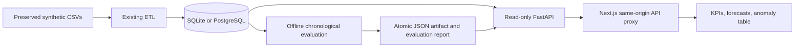

# Phase 3: evaluated demand intelligence, without paid services

This branch adds offline forecasting and historical anomaly screening to the existing Next.js/FastAPI dashboard. It reads the real warehouse tables built from the **bundled synthetic CSVs**; it does not invent business observations. SQLite remains the default. The optional Phase 2 PostgreSQL reader is supported. No OpenAI key, hosted database, Airflow service, or paid resource is required. Main and the live Phase 1 Render deployment are unchanged. Phase 4 is not started.

## What changes in the dashboard

- Market-specific demand forecasts, recent observed history, empirical error bands, candidate comparison, and forecast CSV download.
- Visible forecast origin, final holdout errors, data provenance, and limitations.
- Historical screening of daily orders, delivered revenue, and delivery duration, with observed/expected values and scores.
- SQL-backed cancellation/refund counts, cancellation rate, delivered units, units per delivered basket, and delivered orders taking over 60 minutes. Revenue retains the existing delivered-order definition.
- City filters select the corresponding model. Date filters affect historical KPIs and anomaly flags. **Forecasts always use full market history through the displayed dataset cutoff**, regardless of the selected historical date interval.

There are no stock balances, supplier lead times, receipts, or replenishment records in these datasets. Units sold are a demand measure, not inventory on hand. Stockout rates, turnover, reorder points, and service-level claims are therefore not fabricated.

## Reproducible evaluation

The input contains 3,000 orders from January 1–December 31, 2025. Calendar gaps within that global coverage are filled with zero orders/revenue; this assumes complete source coverage, not an outage. Missing delivery duration remains missing. Duration averages use the number of valid delivered-duration observations as weights.

The daily order candidates are weekly seasonal naïve, a constant trailing 28-day mean, and standardized Ridge autoregression. Ridge uses lags 1/7/14/28, trailing mean/variance, weekday sine/cosine, and trend. Each recursive multi-step prediction uses only available history or its own prior predictions. Minimum history is 180 contiguous calendar days and 28 active days.

Selection uses the lowest mean MAE on three expanding-window, 14-day validation folds. The following 28 days calibrate the absolute-error band; the last 28 days are an untouched final test:

| Period | Dates |
|---|---|
| Validation 1 | September 25–October 8, 2025 |
| Validation 2 | October 9–22, 2025 |
| Validation 3 | October 23–November 5, 2025 |
| Calibration | November 6–December 3, 2025 |
| Final test | December 4–31, 2025 |

Actual all-market results, recorded in [reports/phase3-evaluation.json](reports/phase3-evaluation.json):

| Candidate | Validation MAE | Final test MAE | Final test RMSE | Final test WAPE |
|---|---:|---:|---:|---:|
| Trailing 28-day mean (selected) | 2.382653 | 2.698980 | 3.274048 | 34.825543% |
| Ridge autoregression | 2.562244 | 2.762299 | 3.255362 | 35.642562% |
| Weekly seasonal naïve | 3.357143 | 2.964286 | 3.520349 | 38.248848% |

The simple mean wins validation; there is no claim that ML beats the baseline. MAE/RMSE measure orders per day; WAPE is summed absolute error divided by total actual orders, undefined when that total is zero. City holdout WAPE is roughly 65–89%, so sparse-market predictions are exploratory.

The selected model is refit on all available history for a 14-day forecast. **Origin: December 31, 2025; forecast dates: January 1–14, 2026. This is a historical demonstration, not a current operational forecast.** Expected total is 108.5 orders across those 14 days; fractional values are expectations, not observed orders.

The nominal 80% band uses the finite-sample absolute-residual quantile from calibration, with a lower bound clipped to zero. Observed all-market final-test coverage is 89.285714%; city coverage varies. Serial dependence, recursive horizons, the small calibration set, and changing demand prevent a coverage guarantee. Heldout actuals and full-precision predictions are retained so metrics and coverage can be recomputed independently.

Historical screening uses past-only weekday medians/MAD in a 56-day window (at least 28 valid preceding observations), with pooled-window variance and metric-specific scale floors. Absolute scores of 3.5 or more are flags. There are four all-market flags. These are statistical review candidates: no incident labels exist, so detection precision, recall, business impact, and root causes are unknown. Early/sparse-market flags can be unstable.

## Data and serving architecture



`src/intelligence/data.py` takes a consistent read-only snapshot of the daily/city aggregates. Its canonical SHA-256 fingerprint covers dates, counts, revenue, and duration observations. `/intelligence` compares current inputs with the artifact before serving predictions. Missing or malformed artifacts produce `not_available`; a changed fingerprint produces `stale` and hides forecasts/flags. Historical analytics continue to work. Model training never runs inside a web request. JSON artifacts contain explicit parameters rather than executable pickle objects; API responses omit model parameters.

The ignored `artifacts/intelligence.json` is written by temporary-file replacement. The tracked evaluation report records packages, source coverage, input fingerprint, chronological splits, heldout predictions/errors, and flags. PostgreSQL and SQLite produced the same fingerprint and predictions in workspace verification.

## Run in the Codex cloud workspace

No installation on your own computer is needed. These commands run inside the cloud checkout; loopback addresses below are internal checks, not browser-preview links.

```bash
cd /workspace/foodflow-ai
.venv-api/bin/python -m pip install -r requirements-test.txt -r requirements-postgres.txt
# Only when no warehouse exists: python -m src.pipeline build (never generate/all).
.venv-api/bin/python -m src.intelligence.train --report reports/phase3-evaluation.json
.venv-api/bin/python -m uvicorn api.main:app --host 127.0.0.1 --port 8003
```

In separate persistent sessions:

```bash
FOODFLOW_API_URL=http://127.0.0.1:8003 FOODFLOW_NEXT_DIST_DIR=.next-intelligence NEXT_TELEMETRY_DISABLED=1 npm run build --prefix frontend
FOODFLOW_API_URL=http://127.0.0.1:8003 FOODFLOW_NEXT_DIST_DIR=.next-intelligence NEXT_TELEMETRY_DISABLED=1 node frontend/node_modules/next/dist/bin/next start frontend --hostname 0.0.0.0 --port 3003
```

Use an available platform-forwarded port URL for browser access. This onboarding session does not provide a supported forwarding gateway; raw localhost links will not open the cloud application on your computer. The existing public Render URL continues to show Phase 1 until a separate deployment review.

For PostgreSQL, follow [PHASE2.md](PHASE2.md), then set `FOODFLOW_DATABASE_URL` to the read-only development connection for both training and API. `FOODFLOW_INTELLIGENCE_PATH` can select a different artifact. After a warehouse refresh, train a new artifact before expecting forecasts to return. Review source coverage before interpreting calendar zeroes. Do not overwrite user source batches or warehouse contents during environment setup.

## Validation commands

```bash
FOODFLOW_TEST_POSTGRES_URL=postgresql://postgres@127.0.0.1:55432/foodflow .venv-api/bin/python -m pytest -q
FOODFLOW_WEB_URL=http://127.0.0.1:3003 CHROMIUM_PATH=/usr/bin/chromium npm run test:e2e --prefix frontend
.venv-api/bin/python scripts/verify_phase1.py --web-url http://127.0.0.1:3003
.venv-api/bin/python -m pip check
npm run typecheck --prefix frontend
npm audit --prefix frontend
```

Workspace results: 52 Python tests passed with PostgreSQL enabled; 10 browser tests passed; 10 live warehouse/filter reconciliations passed. Tests cover holdout leakage, recursive model-state reproduction, independent metric recomputation, sparse/invalid data, known injected anomalies, missing/stale artifacts, SQL KPIs, city changes, export, and responsive historical charts. Without the disposable PostgreSQL test DSN/driver, integration tests skip; those skips are not passes. One upstream Starlette/httpx deprecation warning remains. The installed API/ML environment pip-audit and frontend npm audit both reported zero known vulnerabilities on October 22, 2026. Dependency audit results apply to the installed versions and scan date, not an assurance against future vulnerabilities.

## Docker and deployment scope

```bash
docker build -t foodflow-phase3-demo:review .
docker run --rm --memory=512m --cpus=1 -p 127.0.0.1:10003:10000 foodflow-phase3-demo:review
```

The image builds the existing SQLite warehouse and evaluated artifact from bundled CSVs, and packages Next.js standalone output. It runs as UID 10001, keeps FastAPI private on port 8000, and binds the public frontend to `0.0.0.0:$PORT` (default 10000). `/app/deploy/start.sh` remains the entry point; `/app` points to the retained build directory. The database file is read-only. No cloud credentials or source generation are needed. The optional `build_ca` BuildKit secret supports environments with a trusted proxy CA; it is not stored in the image. TLS and package verification remain enabled.

The built Docker image also passed all 10 browser tests and 10 warehouse/proxy reconciliations with a 512 MB memory limit and one CPU. Health checks passed with no OOM kill; UID 10001, the read-only database file, and absence of the build CA/Git metadata were verified. This is a local container check, not a production load test.

A local Docker test does not deploy to Render. Keep Render on its existing free service and Phase 1 branch until explicitly reviewing rollout. The image uses SQLite and does not add hosted PostgreSQL; do not set a PostgreSQL URL without building/installing its optional driver. The GitHub workflow includes intelligence tests when run manually or on relevant pull requests; this branch push does not trigger that workflow, and hosted CI has not been claimed as executed. There is no new paid resource or persistent training schedule.
