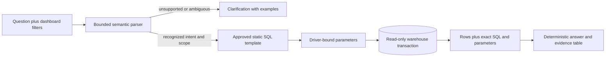

# Phase 4: free warehouse analytics assistant

The dashboard now has **Ask your warehouse**, a natural-language interface backed by actual SQLite or PostgreSQL queries. It requires no model download, external API, API key, or paid service. The original optional OpenAI/Snowflake assistant remains unchanged in `cloud/ai/nl_to_sql.py`.

## Scope and honest limitations

This implementation is a **deterministic semantic parser over approved SQL templates**, not a general-purpose language model. It recognizes supported question patterns, extracts scopes, executes read-only queries, and formats answers from their results. It does not generate SQL from arbitrary prose or invent explanations. Unsupported and ambiguous questions return clarification instead of a guessed answer.

Supported examples:

| Question | Definition |
|---|---|
| What is total revenue? | Delivered-order totals, including delivery fees; not profit |
| How many orders in Denver? | All statuses and delivered count |
| Show delivery performance | Mean recorded delivered duration, observation count, count over 60 minutes |
| Show cancellations | Cancelled count divided by all selected orders |
| Top 5 restaurants by revenue | Delivered-order revenue; deterministic ID tie-break |
| Top 5 foods by units | Delivered item units; item revenue excludes delivery fees |
| Show monthly revenue | Latest 12 observed months, newest first; no imputation |
| Compare cities | Up to 20 cities ranked by delivered revenue within the applied scope |
| Show summary | Orders, delivered orders, delivered revenue |

Rankings accept top 1–10. Supported scopes include known city names, full English month plus year, a year from 1900–2099, and `from YYYY-MM-DD to YYYY-MM-DD` (also `between … and …`). Dates are inclusive. Example: `Revenue in Denver from 2025-03-01 to 2025-06-30`.

Dashboard city/start/end are defaults. A city named in the question overrides city; a question date scope replaces both dates. Other dashboard filters remain active. Every answer displays the actual applied scope, matching count, warehouse coverage, source, and query timestamp. Changing dashboard filters clears the previous answer so it cannot be mistaken for the new selection. “Compare cities” retains dashboard scope too; reset the market filter to compare all cities.

Relative dates, multiple named cities, combined intents, arbitrary SQL, profit, inventory, forecasts, causal explanations, and unsupported ranking measures are refused. Ask one supported question at a time. Questions are independent; there is no conversational memory or pronoun resolution. This is an intentionally bounded no-cost alternative, not a claim of open-ended language understanding. Automated tests cover a defined set of patterns, not accuracy on arbitrary natural language.

All business data remains **synthetic**. Actual bundled warehouse results include $144,709.13 delivered revenue across 2,645 delivered orders; Denver has 528 total orders and 475 delivered. The explicit Denver March–June range returns $8,428.55 and 145 delivered orders. These are observations from the database, not model outputs. Query timestamps describe when the database was read, not when the source data was refreshed; source coverage is January–December 2025.

## Architecture and safeguards



- `POST /assistant` accepts at most 500 question characters, validated ISO dashboard dates, and at most 100 city characters. Extra fields are rejected; clients cannot supply executable SQL.
- The normalized remainder must match a complete approved intent pattern. Unknown modifiers are not silently treated as supported filters.
- City, dates, and ranking limits are bound parameters. Only constant application SQL is executed. No user text becomes a SQL expression or identifier.
- SQLite opens in read-only/query-only mode. PostgreSQL uses the existing read-only reader, transaction isolation, five-second statement timeout, and restricted schema access. Scope counts and answer rows share one snapshot.
- Queries expose aggregates/rankings, not individual customers, review text, credentials, or raw personal records. Rankings/trends have fixed output limits.
- Result tables and exact SQL/parameters are visible in the UI. An empty selection is explicitly labeled; it is not interpreted as evidence of business failure.
- Requests time out in the browser, failures support retry, and requests cancelled by filter changes cannot overwrite a later answer. Only the latest answer is kept in page state; the app does not persist chat history or call external services.

The existing dashboard, offline forecasting, ETL, datasets, and optional cloud integrations remain available. Public deployment still requires the normal service review; this branch does not automatically update Render or main.

## API example

```bash
curl --fail http://127.0.0.1:8004/assistant \
  -H 'Content-Type: application/json' \
  -d '{"question":"What is total revenue in Denver?"}'
```

Responses use `status: answered`, `clarification`, or `unavailable`. Answered responses include `answer`, `intent`, `rows`, `sql`, `parameters`, `filters`, `matching_orders`, `observed_range`, `warehouse_range`, `queried_at`, `source`, `mode`, `notes`, and examples. Clarifications contain no answer rows or executable query. Validation errors return 422; warehouse failures return 503 without connection secrets. The frontend reaches this through the existing same-origin `/api/assistant` proxy.

## Cloud-workspace run instructions

No installation on your own computer is required. Use the existing isolated checkout and dependencies from [PHASE3.md](PHASE3.md). There are no new dependencies. Preserve an existing warehouse; do not regenerate tracked CSVs or run the legacy `generate`/`all` commands. Processes restart after environment restoration.

```bash
cd /workspace/foodflow-ai
.venv-api/bin/python -m uvicorn api.main:app --host 127.0.0.1 --port 8004
```

In other persistent sessions:

```bash
FOODFLOW_API_URL=http://127.0.0.1:8004 FOODFLOW_NEXT_DIST_DIR=.next-assistant NEXT_TELEMETRY_DISABLED=1 npm run build --prefix frontend
FOODFLOW_API_URL=http://127.0.0.1:8004 FOODFLOW_NEXT_DIST_DIR=.next-assistant NEXT_TELEMETRY_DISABLED=1 node frontend/node_modules/next/dist/bin/next start frontend --hostname 0.0.0.0 --port 3004
```

These loopback addresses are internal checks, not user-facing preview links. A platform-forwarded URL is required to access a workspace from your computer. This onboarding session has no supported forwarding gateway. For a public preview, use the existing free Render Docker service after reviewing this branch. Set its branch to `feature/phase-4-warehouse-assistant`, leave Docker Command empty, and manually deploy the latest commit. Keep the Free instance. This changes the public site only; it does not merge main. The existing Dockerfile already includes `api/`, `src/`, and the frontend and needs no new runtime dependency.

For PostgreSQL, follow [PHASE2.md](PHASE2.md) and set the API's `FOODFLOW_DATABASE_URL` to its read-only development reader URL. Never use development trust authentication on a public server. The default Render image remains SQLite and does not include the optional PostgreSQL driver.

## Validation

```bash
FOODFLOW_TEST_POSTGRES_URL=postgresql://postgres@127.0.0.1:55432/foodflow .venv-api/bin/python -m pytest -q
FOODFLOW_WEB_URL=http://127.0.0.1:3004 CHROMIUM_PATH=/usr/bin/chromium npm run test:e2e --prefix frontend
.venv-api/bin/python scripts/verify_phase1.py --web-url http://127.0.0.1:3004
```

82 Python tests passed with PostgreSQL enabled. New tests independently reconcile scoped revenue with SQL, reproduce exposed evidence queries, check date/city precedence and empty selections, reject unsupported/ambiguous/malicious input, enforce size/top-N limits, preserve warehouse bytes, and compare every suggested question across SQLite and PostgreSQL using a restricted reader. One upstream Starlette/httpx deprecation warning remains. These tests do not depend on external AI services or paid infrastructure.

The optimized frontend build and typecheck passed, and npm audit found zero known vulnerabilities. All 14 browser tests and 10 warehouse/proxy checks also passed against the built Docker image under a 512 MB/one-CPU limit. Container health, non-root UID 10001, and the read-only database file were verified, with no OOM kill. This is not a production load test. Browser checks exercise warehouse-grounded answers, exposed SQL, filter invalidation, unsupported questions, failure/retry, 320px result-table/SQL overflow, and the existing dashboard/forecast functionality. Existing live reconciliation checks verify ten historical warehouse/filter cases. Hosted CI is not claimed as executed; this branch does not trigger a push workflow or deploy automatically.
