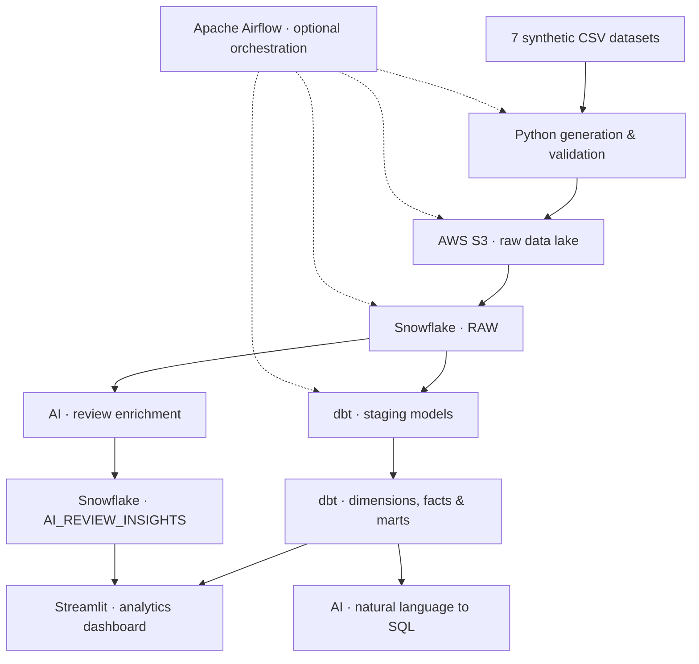

<div align="center">

# FoodFlow AI
### End-to-End Cloud Data Engineering & AI-Powered Food Delivery Analytics

**From raw orders to actionable insights — with a modern red-and-white analytics experience.**


</div>

---

## 📌 Overview

**FoodFlow AI** is a portfolio-scale food-delivery analytics platform built around seven related **synthetic** CSV datasets. It demonstrates how to ingest data into a cloud data lake, load a Snowflake warehouse, model analytics-ready datasets with dbt, and explore business performance through a Streamlit dashboard.

The project also includes two optional generative-AI extensions:

- **Review Intelligence:** enrich customer reviews with sentiment, issue categories, and recommendations.
- **Ask in English (NL-to-SQL):** translate natural-language business questions into validated, read-only Snowflake queries.

The cloud integrations require your own AWS, Snowflake, and OpenAI configuration. The repository also provides a local SQLite demo.

## 🏗️ Architecture



**Data layers:** Source → S3 data lake → Snowflake RAW (bronze) → dbt staging (silver) → dbt analytics marts (gold) → dashboard / AI experiences.

## ✨ Features

| Area | Implementation |
|---|---|
| Data generation | Seven linked CSV datasets with synthetic users, restaurants, menus, orders and reviews |
| Data engineering | Python ingestion, validation, AWS S3 upload, Snowflake raw loading |
| Data modeling | dbt staging models, dimensional tables, fact tables, KPI marts and tests |
| Analytics | Revenue, orders, restaurant performance, top foods and delivery metrics |
| UI | Red-and-white Streamlit dashboard with interactive visualizations |
| AI review intelligence | OpenAI-powered sentiment, issue extraction and recommendations; writes enrichment results to Snowflake |
| Natural-language SQL | Approved-table SQL generation with validation and read-only role enforcement |
| Orchestration | Optional Apache Airflow DAG for the cloud pipeline |
| Offline mode | Local SQLite pipeline and basic Streamlit dashboard |

> **Implementation status:** The source code and offline tests are included. Cloud services and AI features must be configured and validated in your own environment. Review enrichment is triggered manually in the UI; it is not yet part of the Airflow DAG.

## 🗃️ Datasets

| File | Description |
|---|---|
| `users.csv` | Synthetic customer profiles |
| `restaurant.csv` | Restaurant attributes and cuisines |
| `food.csv` | Food reference data |
| `menu.csv` | Restaurant menus and pricing |
| `orders.csv` | Orders, statuses, amounts and delivery information |
| `order_items.csv` | Individual purchased items |
| `reviews.csv` | Customer ratings and text feedback |

The datasets are related through identifiers, enabling referential-integrity checks and multi-table analysis.

## 📊 Analytics models

dbt produces the following core tables:

- **Dimensions:** `DIM_CUSTOMER`, `DIM_RESTAURANT`, `DIM_FOOD`
- **Facts:** `FACT_ORDERS`, `FACT_ORDER_ITEMS`, `FACT_REVIEWS`
- **Marts:** `MART_DAILY_SALES`, `MART_RESTAURANT_PERFORMANCE`, `MART_TOP_FOODS`, `MART_KPIS`

Delivered-order revenue and food-item revenue have different definitions: item revenue excludes delivery fees. See the SQL models for exact metric definitions.

## 🖥️ Dashboard

The cloud dashboard is implemented in `cloud/dashboard.py` and uses a red-and-white theme.

**Add real screenshots here after running the app:**

```markdown


```

Do not present conceptual UI mockups as executed application screenshots.

## 🧪 Quality and testing

```bash
python -m pytest -q
dbt build --profiles-dir .
```

Tests cover aspects of the synthetic data pipeline, data relationships, cloud code contracts and AI helper logic. Offline tests do **not** prove that AWS, Snowflake or OpenAI integrations have run successfully.

## 📁 Project structure

```text
foodflow-ai-cloud/
├── app.py                       # Local SQLite dashboard
├── cloud/
│   ├── dashboard.py             # Red-and-white cloud dashboard
│   ├── upload_s3.py             # S3 ingestion
│   ├── load_snowflake.py        # Snowflake RAW loading
│   └── ai/
│       ├── review_intelligence.py
│       └── nl_to_sql.py
├── src/                         # Synthetic data and local ETL
├── data/raw/                     # Seven sample CSVs
├── models/
│   ├── staging/                  # dbt cleaning / standardization
│   └── marts/                    # Dimensions, facts, KPI marts
├── dags/                         # Airflow DAGs
├── tests/                        # Automated tests
├── .env.example
├── profiles.yml.example
├── requirements-cloud.txt
├── dbt_project.yml
├── AI_FEATURES_SETUP.md
└── README.md
```

## 🔐 Security and cost notes

- Keep S3 buckets private; use minimum-required IAM permissions.
- Exclude `.env`, secrets, local dbt profiles and virtual environments from Git.
- Use a dedicated **read-only Snowflake role** for AI-generated SQL.
- Treat generated SQL and AI summaries as fallible; verify business-critical conclusions.
- AWS S3, Snowflake and OpenAI may incur charges. Set budgets and suspend idle warehouses.
- All included business data is synthetic, not real Zomato or customer data.

## 🛣️ Future improvements

- Incremental ingestion and CDC instead of full raw-table refresh
- Schedule review enrichment with Airflow
- Add query audit logs and stronger SQL governance
- Add data freshness monitoring and alerting
- Deploy the dashboard and add verified execution screenshots

## 📚 Acknowledgments

Built as an independent learning and portfolio implementation, inspired by common food-delivery analytics architectures. Developed with AI-assisted coding support; verify and customize the implementation before presenting it as completed production work.

---

<div align="center">

**FoodFlow AI** · Data Engineering × Analytics × Generative AI

*From raw food-delivery data to better business decisions.*

</div>
