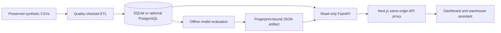

# FoodFlow AI

A Food Supply Chain Intelligence Platform demonstrating data engineering, SQL analytics, evaluated forecasting, and a warehouse-backed question interface. The working dashboard uses **Next.js, React, Tailwind CSS, and FastAPI**. All included business observations are **synthetic food-delivery data**.

The default demo runs as one Docker service with bundled SQLite, offline model artifacts, and no paid API or hosted database. Optional PostgreSQL demonstrates a deeper warehouse workflow. Existing Streamlit, AWS, Snowflake, dbt, Airflow, and OpenAI integrations remain in the repository; external integrations are optional and require separate configuration and validation.

## What works

| Area | Implementation |
|---|---|
| Dashboard | Responsive KPI cards, interactive demand charts, city/date filters, rankings, CSV export |
| Data engineering | Typed source contracts, quality gates, row-hash incremental upserts, atomic publication, run logs, retry and advisory locking |
| SQL modeling | Customer/restaurant/food dimensions, order/item/review facts, reporting marts, restricted PostgreSQL reader |
| Demand intelligence | Seasonal naïve, trailing mean and Ridge candidates; chronological validation/calibration/holdout; empirical bands; stale-artifact rejection |
| Anomaly screening | Past-only robust daily orders/revenue/duration flags; no unsubstantiated accuracy claims |
| Natural-language analytics | Free bounded semantic parser, static parameterized SQL, visible results and scope, clarification for unsupported questions |
| Release engineering | Exact Python dependency snapshots, npm lock, manual CI definition, release reconciliation, Docker recovery checks, rollback runbook |

The all-market warehouse contains **3,000 orders**, **2,645 delivered orders**, and **$144,709.13 delivered revenue**. These values are SQL results, not invented metrics. The selected forecasting baseline has final-test MAE **2.70 orders/day** and WAPE **34.83%**; sparse-market errors are higher. Forecasts use the December 31, 2025 dataset cutoff and are historical demonstrations, not current operational predictions. See [model evidence](reports/phase3-evaluation.json).

There are no on-hand inventory or supplier records. Units sold are not stock levels; inventory turnover, reorder points, profit, and causal explanations are not fabricated.

## Architecture



See [architecture and dimensional model](docs/ARCHITECTURE.md) and the [release/rollback runbook](docs/RELEASE_RUNBOOK.md).

## Run and validate in the cloud workspace

No installation on your own computer is required. Run these in the existing Codex checkout. Python 3.12, Node 22, and a Chromium browser are the validated toolchain.

```bash
cd /workspace/foodflow-ai
python -m venv .venv-api
.venv-api/bin/python -m pip install -r requirements-test.lock -r requirements-test.txt -r requirements-postgres.txt
.venv-api/bin/python -m pip check
.venv-api/bin/python scripts/check_dependencies.py --lock requirements-test.lock
npm ci --prefix frontend --no-fund --no-audit
# Only for an absent warehouse; never regenerate the preserved CSV sources.
test -f warehouse/foodflow.db || .venv-api/bin/python -m src.pipeline build
.venv-api/bin/python -m src.intelligence.train
FOODFLOW_PYTHON=.venv-api/bin/python CHROMIUM_PATH=/usr/bin/chromium bash scripts/validate_web.sh
```

The validation command builds and starts an isolated API/frontend pair, runs browser tests and release reconciliation, then stops only its own processes. If system Chromium is unavailable, install Playwright Chromium using the frontend's locked Playwright version and omit `CHROMIUM_PATH`. For persistent development services use [Phase 4 startup instructions](PHASE4.md); for a public browser preview use [Render deployment instructions](docs/RENDER_DEPLOYMENT.md). Internal localhost addresses do not open the cloud machine in your own browser.

For the full PostgreSQL integration suite, start the local development database as described in [PHASE2.md](PHASE2.md), then run:

```bash
FOODFLOW_TEST_POSTGRES_URL=postgresql://postgres@127.0.0.1:55432/foodflow .venv-api/bin/python -m pytest -q
```

The test DSN must identify a disposable development server: fixtures create/drop uniquely named test databases and roles. Without it, PostgreSQL tests skip; skips do not establish readiness.

## Implementation guides

| Phase | Guide |
|---|---|
| 1 · Frontend and API | [PHASE1.md](PHASE1.md) (historical phase record) |
| 2 · Incremental warehouse | [PHASE2.md](PHASE2.md) |
| 3 · Evaluated forecasting | [PHASE3.md](PHASE3.md) |
| 4 · Free warehouse assistant | [PHASE4.md](PHASE4.md) |
| 5 · Release verification and operations | [PHASE5.md](PHASE5.md) |

## Preserved integrations and repository layout

`data/raw/` contains the seven linked synthetic datasets. `src/pipeline.py` retains the SQLite build; `src/warehouse/` owns the optional PostgreSQL ETL. `sql/` and `models/` contain reporting/dimensional models, `src/intelligence/` contains offline evaluation, `api/` contains read-only serving, `frontend/` contains the dashboard, and `scripts/` contains operating checks.

The original SQLite Streamlit application remains in `app.py`. The optional cloud dashboard, S3 ingestion, Snowflake loading, review enrichment and NL-to-SQL remain in `cloud/`; dbt configuration is at the repository root and Airflow examples are in `dags/`. See [AI_FEATURES_SETUP.md](AI_FEATURES_SETUP.md), `.env.example`, `profiles.yml.example`, and the historical phase guides. Review enrichment is manual; it is not silently scheduled by the current ETL or release workflow. AWS, Snowflake and OpenAI can incur charges and are not needed for the free platform.

## Operational limits

This is a validated portfolio/demo implementation, not a claim of unattended enterprise production operation. The public demo has no application authentication and contains only synthetic data. Render's free service can sleep and has account-dependent build/usage quotas. Hosted CI has not been executed by this phase; the manual workflow requires review and availability on the default branch. No push from this branch deploys or creates paid resources. Real customer data, persistent production ingestion, load/SLA targets, and external integrations need separate operational work.

Built as an independent learning and portfolio project with AI-assisted coding. Present the measured results and limitations alongside the implementation.
