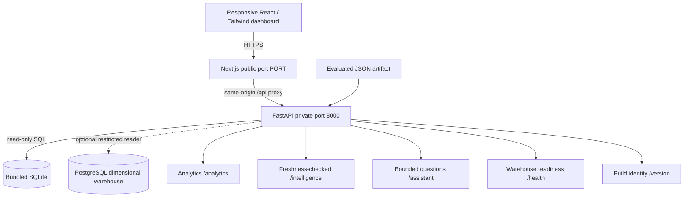
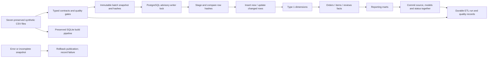
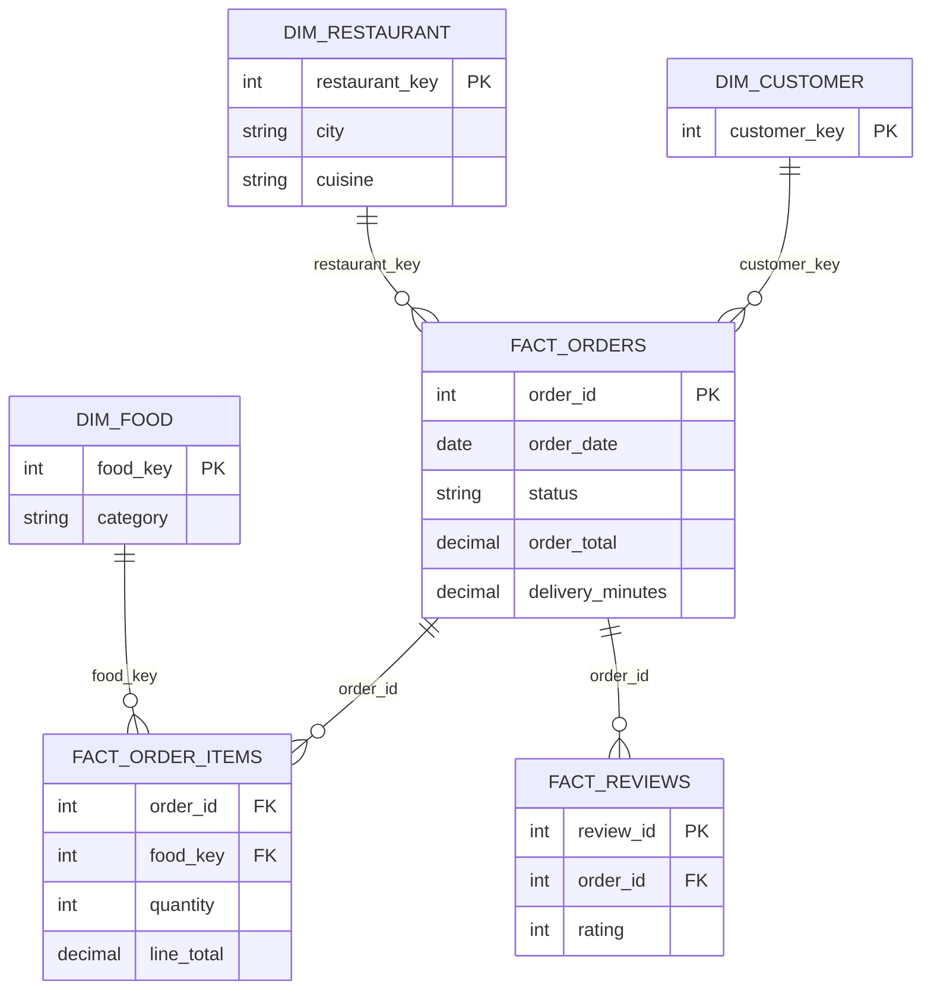

# Platform architecture and data contracts

## Serving path



The free Render demo is a **single Docker service**, not a distributed deployment. Only Next.js is public; browser requests never point at a private localhost API. Next.js rewrites `/api/*` to the container's private API at build time. `deploy/start.sh` waits for API readiness, supervises both children, and exits when either dies. Host supervision can restart the container. The image runs as UID 10001 and opens its bundled database read-only. `PORT` must be nonprivileged and differ from private API port 8000.

SQLite and PostgreSQL are alternatives, not synchronized production replicas. Without `FOODFLOW_DATABASE_URL`, FastAPI reads SQLite. With the variable, the optional psycopg adapter uses a restricted analytics reader, read-only repeatable-read transactions, a five-second statement timeout, and restricted schema search path. The default Render image intentionally does not install the optional PostgreSQL driver or provision a database.

## Data engineering path



[PHASE2.md](../PHASE2.md) defines commands, schema names, idempotent retry, late arrivals, corrections, completeness checks, failure recovery, and reader grants. Incrementality means changed rows are published, not that the loader assumes ordered event arrivals. Deletes from an incomplete snapshot are rejected; this is not a CDC log or a full slowly-changing-dimension history. No Airflow deployment is needed for the current single transaction-owning batch; optional legacy DAGs remain in the repository.

## Warehouse grain and business semantics



An order is one row in `fact_orders`; items are line items and must not multiply order-level revenue when joined. Delivered revenue sums delivered order totals, including delivery fees. Item revenue sums delivered line totals, excluding fees. Fulfillment and cancellation denominators are all selected orders. Delivery means use non-null delivered-duration observations. The over-60-minute measure is descriptive, not an SLA. City and inclusive date scopes are applied consistently. Source coverage dates describe observations, not ingestion freshness.

The seven synthetic sources are users, restaurants, foods, menus, orders, order items, and reviews. They contain no supplier purchase orders, on-hand stock, inventory receipts, capacity plans, or stockout labels. Stock turnover, reorder points, causal business explanations, and financial profit are not inferred from missing data.

## Model and assistant path

```mermaid
sequenceDiagram
  participant Trainer as Offline trainer
  participant DB as Read-only warehouse
  participant File as Atomic JSON artifact
  participant API as Intelligence endpoint
  Trainer->>DB: Consistent daily/city snapshot
  Trainer->>Trainer: Calendar assumptions and SHA-256 fingerprint
  Trainer->>Trainer: Expanding validation -> calibration -> final holdout
  Trainer->>Trainer: Select baseline or Ridge; refit selected method
  Trainer->>File: Atomic evaluated artifact replacement
  API->>DB: Recompute current input fingerprint
  API->>File: Read evaluated artifact
  alt inputs match
    API-->>API: Serve predictions and evidence
  else inputs changed or artifact absent
    API-->>API: Hide stale predictions; historical analytics remain usable
  end
```

[PHASE3.md](../PHASE3.md) and the [recorded evaluation](../reports/phase3-evaluation.json) describe the chronological splits, 14-day forecast, empirical bands, and limitations. The mean baseline won all-market validation; the final test has MAE 2.698980 and WAPE 34.825543%. Forecast origin is December 31, 2025, not today. Robust historical anomaly flags have no labeled precision/recall estimate. Training is offline; API requests never fit a model or execute pickle code.

[PHASE4.md](../PHASE4.md) describes the free assistant. Complete pattern matching extracts one supported intent and explicit scopes; driver-bound parameters populate static SELECT templates. Unsupported questions clarify. Every answer exposes results, applied scope, SQL, parameters, and query time. This is not a general-purpose LLM and does not call paid APIs. Original optional OpenAI/Snowflake modules remain separate and require their own configuration.

## Release path

```mermaid
flowchart LR
  Review[Reviewed feature commit] --> Lock[Exact Python locks and npm lock]
  Lock --> Test[PostgreSQL and Python tests]
  Test --> Build[Warehouse, artifact and Next.js build]
  Build --> Browser[Browser and SQL reconciliation]
  Browser --> Audit[Dependency audit]
  Audit --> Container[Optional container recovery gate]
  Container --> Manual[Manual free Render deployment]
  Manual --> Verify[HTTPS health, revision and functional checks]
  Verify -->|failure| Rollback[Previous validated deployment]
```



The new workflow is manual and read-only to GitHub; it has no deployment credentials, registry push, cron schedule, or paid service creation. The feature branch does not activate a workflow on main. See [RELEASE_RUNBOOK.md](RELEASE_RUNBOOK.md) for prerequisites, exact commands, evidence, quotas, and rollback.
